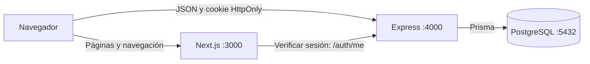

# Arquitectura de Entre páginas

## Tres servicios, una responsabilidad principal por servicio

El navegador recibe las páginas de Next.js y hace las operaciones del catálogo contra Express. Express valida solicitudes, comprueba sesiones y ejecuta las reglas de negocio. Prisma traduce las operaciones del backend a consultas PostgreSQL.

En Compose, `backend` y `postgres` son nombres de servicio que resuelven en la red interna. El navegador no puede usar esos nombres: llama a `http://localhost:4000`. El puerto PostgreSQL publicado al host es 5433, aunque los contenedores usan 5432.

## Desde el login hasta un libro guardado

1. El formulario envía correo y contraseña a `POST /auth/login` con `credentials: include`. El navegador añade Origin.
2. Express comprueba el origen y valida el cuerpo con Zod. El servicio normaliza el correo, consulta el usuario y compara la contraseña con el hash bcrypt. Nunca necesita recuperar una contraseña original.
3. Si coincide, el backend firma un JWT con el ID del usuario y una expiración. Lo envía mediante Set-Cookie; el JSON contiene únicamente el usuario público.
4. El navegador conserva la cookie y la envía en las peticiones correspondientes. El frontend entra en `/catalogo`; su layout de servidor consulta `/auth/me` para verificar la sesión antes de mostrar el área protegida.
5. Al agregar un libro, el formulario valida los campos y envía JSON a `POST /books`. La cookie se incluye automáticamente.
6. El middleware de Express verifica firma, algoritmo, expiración, issuer y audience del JWT, y confirma que el usuario todavía existe en PostgreSQL.
7. El controlador valida el libro con Zod. El servicio coordina la creación y el repositorio ejecuta `prisma.libro.create`.
8. PostgreSQL aplica NOT NULL, el índice único de ISBN y las restricciones de páginas y año. Incluso dos peticiones simultáneas no pueden guardar el mismo ISBN.
9. Express responde 201 con el libro creado y Location. El frontend vuelve al catálogo, consulta el listado real y muestra la confirmación. Si hay ISBN duplicado, responde 409 y el formulario marca ese campo.

El registro realiza un flujo parecido: genera el hash bcrypt, inserta el usuario y establece una sesión. El logout expira la cookie del navegador; no existe una lista central de revocación de tokens.

## JWT y cookies HttpOnly

Un JWT está firmado, no cifrado. La firma permite comprobar que no fue alterado; por eso no debe contener contraseñas ni otros secretos. Aquí contiene el sujeto UUID y los campos de control de sesión.

HttpOnly impide que el código JavaScript lea directamente la cookie. No evita por sí sola todos los ataques XSS o CSRF. SameSite=Lax, la comprobación explícita de Origin y CORS con un origen concreto complementan la protección. Secure exige HTTPS cuando se activa en producción.

La protección del layout sirve para navegación y experiencia de usuario. La seguridad del catálogo depende también del middleware del backend: llamar directamente a la API sin sesión devuelve 401. El token no se confía por su mera presencia; siempre se verifica.

## Responsabilidades del backend

- `routes`: relaciona método y URL con middleware y controlador.
- `controllers`: valida la entrada, llama al servicio y construye la respuesta HTTP.
- `services`: implementa operaciones y transforma casos esperados, como ISBN duplicado o libro inexistente, en errores del dominio HTTP de la aplicación.
- `repositories`: contiene las consultas Prisma. No conoce formularios ni navegación.
- `middleware`: aplica autenticación, comprobación de origen y formato común de errores.
- `config` y `lib`: validan variables y comparten el cliente Prisma, las opciones de cookie y el tipo de error esperado.

Las validaciones del navegador son una ayuda. El backend vuelve a comprobarlas porque una persona puede omitir el formulario y llamar directamente a Express.

## Docker, migraciones y seed

Cada aplicación tiene un Dockerfile con construcción y ejecución separadas. El frontend usa la salida standalone de Next.js. El backend conserva Prisma CLI para aplicar migraciones al arrancar. Las aplicaciones corren como usuario `node`.

Compose crea la red, el volumen PostgreSQL y las dependencias de salud. Al arrancar, el backend ejecuta `prisma migrate deploy`, después el seed compilado y finalmente Express. El frontend espera a la salud de Express.

`schema.prisma` describe los modelos. La migración SQL versionada crea tablas, índices y restricciones que no se expresan completamente en el esquema Prisma. Los cambios futuros de estructura deben introducir una nueva migración; no se modifica manualmente la base para que el código funcione.

El seed usa upserts en una transacción. Si el usuario o libro existe, no lo sobrescribe; si falta un libro de demostración, lo vuelve a crear. Desactivar `SEED_DEMO` evita este comportamiento. El volumen conserva la base al recrear los contenedores.

## Decisiones y alternativas para la entrevista

Se eligió Express independiente en vez de Route Handlers para hacer visible la separación de servicios. La división en cuatro capas permite explicar dónde vive cada responsabilidad sin introducir un framework adicional.

JWT simplifica la sesión para esta prueba; una tabla de sesiones o una lista de revocación permitiría invalidación inmediata, a costa de estado adicional. Guardar el token en localStorage sería sencillo, pero lo expondría directamente a JavaScript.

Prisma reduce SQL repetitivo, mientras PostgreSQL sigue siendo responsable de la integridad. Los índices únicos solucionan las carreras de concurrencia mejor que una comprobación previa de existencia por sí sola.

Las portadas CSS y los componentes compartidos mantienen el diseño y el alcance. Las migraciones automáticas facilitan la evaluación local; en un despliegue con varias réplicas convendría ejecutarlas una vez como trabajo de publicación.
